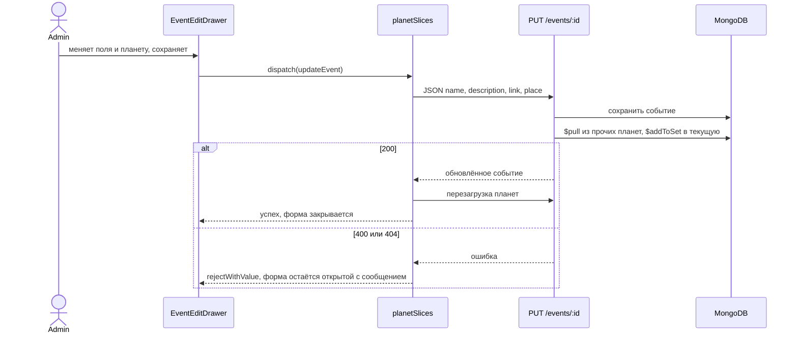

# Design

## Context

Создание события идёт через `EventCreateDrawer` и thunk `createEvent`, который отправляет `FormData`. Сервер принимает `PUT /events/:id` только как JSON и не меняет снимки. После мутаций слайс перезагружает список планет вместе с событиями.

## Goals / Non-Goals

**Goals:**
- редактировать событие из той же карточки планеты, где его создают и удаляют

**Non-Goals:**
- редактирование снимков

## Decisions

- Отдельный `EventEditDrawer`, а не режим `EventCreateDrawer`: в форме создания есть загрузка снимков и `FormData`, в форме редактирования их нет, общий компонент держал бы две ветки поведения.
- `updateEvent` отправляет JSON, потому что `PUT /events/:id` не разбирает multipart.
- После успешного `updateEvent` вызывается та же перезагрузка планет, что после `createEvent`: перенос события меняет хронику двух планет сразу.

## Interaction

## Risks / Trade-offs

- [Перезагрузка всех планет после каждого изменения] → объём данных карты небольшой, тот же подход уже используется для создания и удаления.
