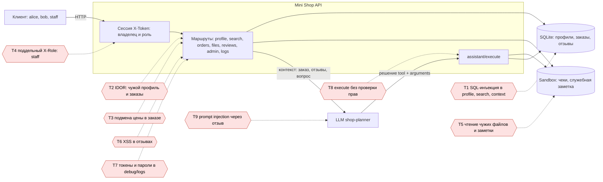

# Отчёт 1. Атаки на исходный сервис

## Модель угроз

Mini Shop принимает HTTP-запросы от клиентов, хранит профили и заказы в SQLite, читает чеки из временного каталога и передаёт заказ, отзывы и вопрос пользователя AI-помощнику. Границы доверия проходят между клиентом и API, API и SQLite, API и файловым sandbox, а также между API и LLM. Токен сессии является единственным источником личности.

Активы: персональные данные профилей, адреса, заказы, чеки и служебная заметка. Угрозы: подмена владельца и роли, SQL-инъекция, чтение чужих данных, изменение цены, XSS в отзывах, утечка токенов в журнале и выполнение опасного решения AI-помощника. Атакующий имеет доступ только к своему локальному HTTP-процессу и синтетическим данным.

## Найденные и воспроизведённые проблемы

1. `/profile`, `/search` и `/assistant/context` строили SQL через f-string. Запрос `id=1 OR 1=1` возвращал чужие строки, а специальные значения ломали запрос.
2. `/profile?id=2` и `/orders` не проверяли владельца. Клиент Alice видел профиль и заказ Bob.
3. `/orders` принимал `price` из тела запроса, поэтому товар можно было купить за 1 рубль.
4. `/admin/export` доверял заголовку `X-Role: staff`, не проверяя сессию.
5. `/files` позволял указать другого пользователя и произвольный путь внутри sandbox, включая `private/operator-note.txt`.
6. `/reviews/view` вставлял отзыв в HTML без экранирования, что позволяло сохранить XSS.
7. `/debug/logs` был доступен без авторизации и содержал `X-Token` и пароли из тела `/login`.
8. `/assistant/execute` не проверял сессию, владельца файла и права инструмента. Изготовленное решение могло экспортировать профили или удалить дерево файлов.
9. Контекст помощника включал отзывы как инструкции. Вредоносный отзыв мог быть prompt injection и влиять на решение LLM.

Атаки выполнялись только против локального процесса с тестовыми данными. Первые восемь проблем воспроизводятся обычными HTTP-запросами и тестами; prompt injection проверен на реальной модели, результат в REPORT_02.
